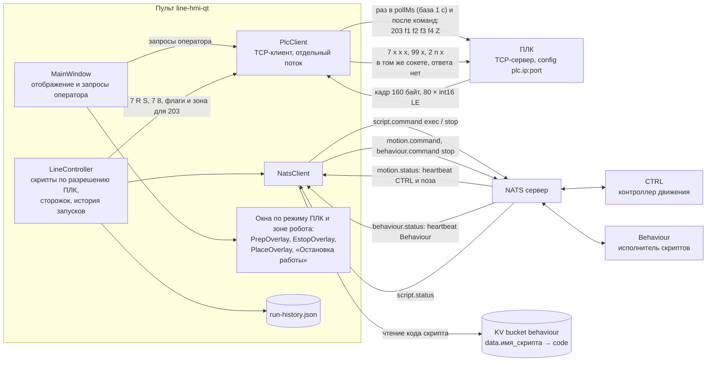
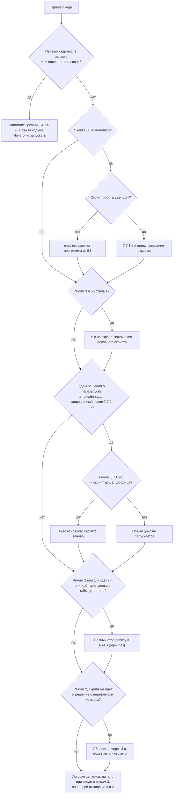

# Логика пульта line-hmi-qt: ПЛК, робот, режимы

Схема собрана по коду: `src/MainWindow.cpp`, `src/LineController.*`, `src/PlcClient.*`,
`src/NatsClient.cpp`, окна `src/PrepOverlay.cpp`, `src/EstopOverlay.cpp`, `src/PlaceOverlay.cpp`.

Все решения о линии принимает ПЛК: можно ли стартовать, когда идёт предподготовка, когда
перезапускать цикл, когда авария, сколько годных и брака, можно ли выключать питание.
Пульт передаёт запросы оператора, показывает кадр состояния ПЛК и, пока скрипты робота живут
в NATS, запускает их по разрешению ПЛК и сообщает ему о результате.

Протокол с ПЛК (команды, ячейки кадра, коды, режимы и сценарии со стороны ПЛК) описан
в [PLC_PROTOCOL.md](PLC_PROTOCOL.md). Здесь — как это устроено внутри пульта.

## 1. Кто с кем и как общается

`MainWindow` только рисует кадр и отправляет запросы оператора. Всё, что пульт делает без
оператора, живёт в `LineController` (QObject без интерфейса).

## 2. Что пульт отправляет в опросе `203`

`LineController` каждые 500 мс собирает отчёт о роботе и передаёт его в `PlcClient`, тот
вставляет его в следующий опрос `203 f1 f2 f3 f4 Z`:

| Байт | Откуда |
|---|---|
| `f1` | NATS подключён |
| `f2` | `motion.status` приходил меньше 2 с назад |
| `f3` | `behaviour.status` приходил меньше 2 с назад |
| `f4` | Behaviour жив и идёт скрипт (`script.status.running` или скрипт, запущенный пультом, ещё не закончился) |
| `Z` | номер стартовой зоны (1..4), в которой стоит робот по свежей позе из `motion.status`; 0 — ни в одной или позы нет |

Стартовые зоны задаются в админке («Стартовые зоны робота…») и хранятся в `config.json`
в разделе `robot.startZones`: четыре прямоугольные области по `x, y, z, r`, каждую можно выключить.

## 3. Запросы оператора и как пульт понимает, что ПЛК их принял

ПЛК на команды не отвечает. После команды пульт шлёт внеочередной опрос и 3 с смотрит
на кадры. Если ожидаемое изменение не пришло, в журнал пишется «ПЛК не принял «…»».
Для «Выйти из E-STOP» к сообщению добавляются активные причины аварии (раздел 6).

«Старт» без выбранной оператором детали пульт на ПЛК не шлёт: пишет в журнал и показывает
«Сначала выберите деталь, затем нажмите «Старт»». При старте пульта выбор пустой. После
«Стоп» пульт сбрасывает выбор в интерфейсе, когда в кадре режим ушёл из 3; `7 1 0 X` при
стопе не шлёт. При входе в Estop шлёт `7 1 0 X`. Ячейка 54 сама по себе деталь не выбирает.

Сообщение показывается в окне аварии или ручной установки, если оно открыто, иначе —
в немодальном окне (следующий запрос его закрывает).

| Кнопка | Кадр | Принято, когда |
|---|---|---|
| «Деталь 1» / «Деталь 2» | `7 1 N X`, `X = 0`, если в админке «Игнорировать тензодатчик» | ячейка 54 = `N` |
| «Старт» | `7 2 0 0` | режим (52) ушёл из 1 «готов» |
| «Стоп» | `7 3 0 0` | режим ушёл из 3 «в работе»; выбор детали в UI сбрасывается по этому кадру |
| «Выйти из E-STOP» | `7 5 0 0` | режим ушёл из Estop |

Кнопки пульт включает по режиму ПЛК: «Старт» — в режиме 1, если все пункты готовности
в панели слева выполнены (NATS, CTRL, Behaviour, Vision 1 и 2, связь с ПЛК, клапаны сварки,
стартовая зона, деталь); иначе кнопка неактивна, а плашка — «НЕ ГОТОВО». Ручные пункты
«Перед выходом» в окне аварии выглядят иначе, чем автоматические: синяя пунктирная рамка, ☐ и
подсказка «Нажмите, чтобы подтвердить»; после нажатия — зелёные с ☑. «Стоп» — в режиме 3;
выбор детали — в режиме 1 и при загрузке ПЛК.
«Старт» и выбор детали неактивны, пока идёт скрипт робота, запущенный пультом: ПЛК мог уйти
в режим 1, не дождавшись `7 8`. В этом случае пульт доводит скрипт как при стопе и показывает
окно «Остановка работы» и плашку «СТОП». Решение принимает ПЛК.

## 4. Что пульт показывает по кадру

| Ячейка | Где на экране |
|---|---|
| 52 режим | плашка «Готовность · …», заголовок чек-листа, окна по режиму (раздел 6); режим 2 — окно «Остановка работы», кнопка «Стоп» → «Остановка…» |
| 56 предподготовка закончена | в режиме 3: 0 — окно предподготовки и плашка PREP, 1 — плашка RUN |
| 54 программа | выбранная деталь и схема подачи — только после нажатия «Деталь 1/2» в этом сеансе |
| 32 датчик импульса сварки | сопроводительные логи / сервисный буфер; решений пульт не принимает |
| 51, 59, 61, 65, 66, 67 причины аварии | список причин в окне аварии, строка «Авария: …» в чек-листе (раздел 6) |
| 62, 63 годные и брак | показатели справа |
| 64 можно выключать | «Можно выключать питание · ДА/НЕТ» |
| 69; 25 и 1; 10..14, 16 | строки окна предподготовки (раздел 6) |
| 69 тип ламели на выдаче | «На выдаче: тип T / пусто» в блоке «Ламели» на схеме; «пусто» — не авария, авария только по 59 |
| 10..14, 16; 57, 58 | индикатор сварки и строка чек-листа (все клапаны = 1 — «Готов», открыты в режиме 3 — «В работе»), Vision 1 и 2 |

Плашка: «УСТАНОВКА» — режим 1, а робот вне стартовых зон; «OK» — режим 1 и деталь выбрана;
«НЕТ ДЕТАЛИ» — режим 1, деталь не выбрана (в этом случае в чек-листе ещё и строка «Выберите
деталь»); дальше по режиму: PREP (3, 56 = 0), RUN (3, 56 = 1), СТОП (2), АВАРИЯ, СЕРВИС,
ЗАГРУЗКА, НЕТ ПЛК.

## 5. LineController: реакция на кадр ПЛК

Конец скрипта пульт определяет по `script.status` с тем же `filename`:

- `running: true` — скрипт пошёл;
- `running: false` после `running: true` — скрипт закончился, `completed` говорит, дошёл ли он
  до конца;
- статусы о конце, пришедшие раньше, чем `exec` ушёл в NATS, относятся к прошлому запуску
  того же файла и пропускаются.

Когда скрипт закончился:

- init → `7 7 1 S` и внеочередной опрос; задача «Робот готов» в окне предподготовки становится
  выполненной или ошибочной;
- основной → `7 7 2 S`, время цикла (если дошёл), внеочередной опрос. Решение о перезапуске
  принимается только по кадру, запрошенному после `7 7 2 S` (`PlcClient::pollNow()` возвращает
  номер опроса, `pollServed()` — номер последнего обслуженного). Так стоп, нажатый в последнюю
  секунду цикла, не теряется.

Если скрипт не удалось прочитать из KV или отправить `exec`, пульт сразу шлёт ПЛК `7 7 R 0`.
Если в ячейке 54 программа, для которой в админке не задан скрипт, — тоже `7 7 R 0`.

Стоп в цикле ждёт конца текущего цикла не дольше таймаута из админки («После «Стоп» ждать
конца цикла», по умолчанию 30 с, 0 — без ограничения; `programs.stopTimeoutSec` в config.json).
Дальше пульт шлёт роботу полный стоп. Если после полного стопа (в цикле или предподготовке) робот за 5 с
не прислал `script.status` о конце, пульт считает скрипт законченным: `7 7 R 0`, затем `7 8`.
Так стоп не зависает, когда скрипт робота висит, например, на `tcp_send_comand` без связи с ПЛК.

Если ПЛК в Estop, пульт `7 8` не шлёт: линию из аварии выводит оператор через `7 5`.

## 6. Окна по режиму ПЛК

| Когда | Окно | Что в нём |
|---|---|---|
| режим 3 или 2 во время предподготовки текущего запуска, или 5 с до основного | PrepOverlay «Предподготовка» | «Ламель на выдаче» (69 ≠ 0), «Большие / малые держатели ламелей на месте» (Деталь 1 — 25 = 1, Деталь 2 — 1 = 1), «Робот готов» (init-скрипт), «Клапаны сварки в безопасном положении» (10..14, 16 все = 1); после 56 = 1 один раз — «Основная программа через N с»; кнопка «Стоп» → `7 3`. После Стопа и нового Старта окно открывается снова, init запускается заново (в т.ч. если ячейка 60 не изменилась) |
| 4 Estop | EstopOverlay «Авария» | «Причины» — все активные причины аварии (ниже); строка о стартовой зоне; «Перед выходом» — «Выключите вакуум», «Разожмите сварку руками» и «Убедитесь, что всё нормально» отмечает оператор нажатием; «Выйти из E-STOP» → `7 5`, активна, когда цепь e-stop в норме (51 = 1) и все три пункта отмечены |
| режим 1, поза робота известна, `Z = 0` | PlaceOverlay «Выставьте робота вручную» | картинка стартового положения из админки, текущая зона робота; кнопок нет — пульт закрывает окно сам, когда робот в зоне |
| режим 2 | «Остановка работы» | без кнопок, закрывается, когда режим сменился |

Окно закрывается, как только условие перестало выполняться.

### Причины аварии

Кода аварии нет: `LineController::alarmCauses()` собирает все активные причины сразу, их может
быть несколько. Список обновляется по каждому кадру и раз в секунду:

| Причина | Откуда |
|---|---|
| Отожмите грибок и/или закройте двери | 51 = 0 (грибок и двери в одной цепи) |
| Долго нет ламелей | 59 = 1 |
| Долго нет держателей ламелей малых | 61 = 1 или 3 |
| Долго нет держателей ламелей больших | 61 = 2 или 3 |
| Сварка долго не отрабатывает | 65 = 1 |
| Долго не можем взять держатель | 66 = 1 |
| Долго не можем взять ламели | 67 = 1 |
| Скрипт робота не дошёл до конца | пульт сам: последний скрипт закончился с `completed: false` не из-за стопа и не из-за потери ПЛК; сбрасывается новым запуском скрипта или выходом ПЛК из аварии |
| Нет связи с NATS / CTRL не отвечает / Behaviour не отвечает | пульт сам (те же флаги, что `f1`..`f3` в `203`) |
| Vision 1 / Vision 2 не работает | 57 / 58 = 0 |
| Клапаны сварки не в безопасном положении | 10..14, 16 не все = 1 |

Стартовая зона в список не входит: окно показывает её отдельной строкой («после выхода
выставить вручную», если `Z = 0`). Те же причины уходят в журнал при входе в аварию, в строку
«Авария: … и ещё N» в чек-листе и в причину завершения запуска в истории.

## 7. Потеря связи с ПЛК

Если `LineController` 3 с не видит кадра (`PlcClient::isOk()`), он:

1. пишет в журнал «Нет связи с ПЛК»;
2. шлёт роботу полный стоп в NATS (`motion`, `behaviour`, `script`);
3. закрывает текущую запись истории с причиной «Нет связи с ПЛК»;
4. перестаёт ждать решения о перезапуске: без свежего кадра новый цикл не начнётся.

Команды, которые стояли в очереди на ПЛК, отбрасываются с записью «Команда не отправлена:
нет связи с ПЛК». Когда связь вернулась, первый кадр берётся как исходный (раздел 5) — пульт
ничего не запускает сам, даже если ПЛК в режиме 3.

## 8. История запусков

Запуск — от входа линии в режим 3 до выхода из режимов 3 и 2. На каждый запуск в
`AppDataLocation/run-history.json` пишется запись (храним последние 1000):

- деталь (54), начало и конец;
- годные и брак за запуск — разница ячеек 62 и 63 между началом и концом (по модулю 32768);
- число циклов, среднее и последнее время цикла (меряет пульт: от `exec` до конца скрипта);
- причина: «Стоп», «Авария · <причины через запятую>», «Нет связи с ПЛК» или «ПЛК завершил работу».

Кнопка «История запусков» показывает последние 50 записей, новые сверху.

Показатели «Годные» и «Брак» справа на экране — это счётчики ПЛК (62, 63), они обнуляются
при смене детали, а не при каждом запуске.

## 9. Админка

Админка (пароль у наладчика) — прямое управление в обход ПЛК: приводы, ручное перемещение,
точки `robot_points`, сервисный режим (`99`) и дискретные выходы (`2 n v`), имена init
и основных скриптов, стартовые зоны и картинка для ручной установки, тензодатчик (`7 1 N X`
с текущей программой; переключатель активен, когда 54 > 0), «Сопроводительные логи» —
окошко текущего кадра ПЛК справа снизу на главном экране.
