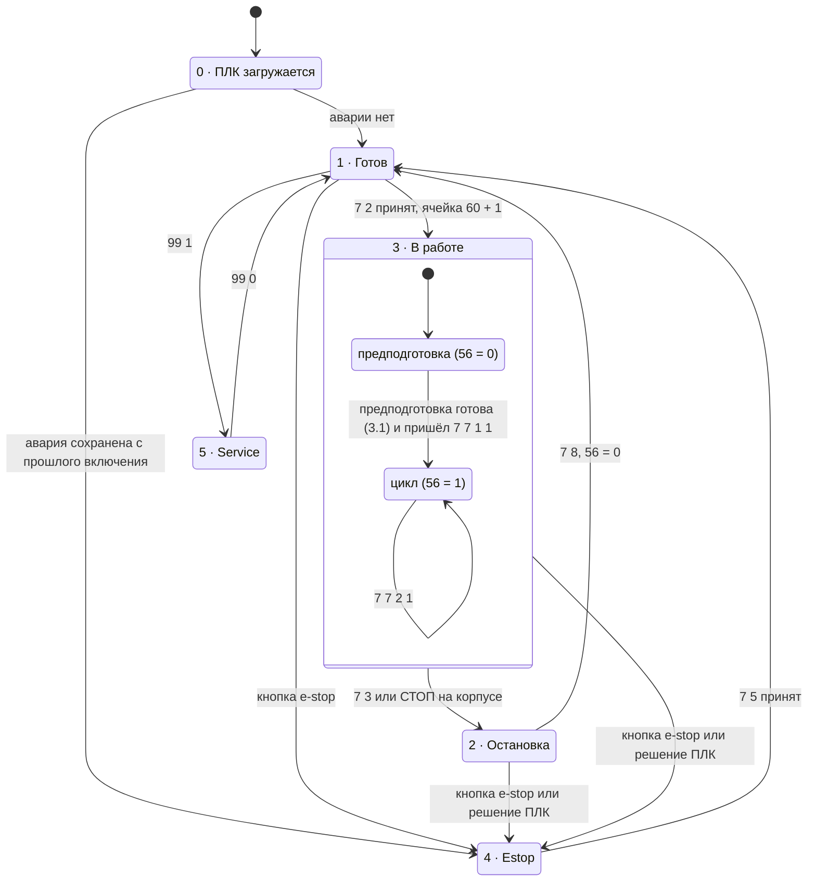
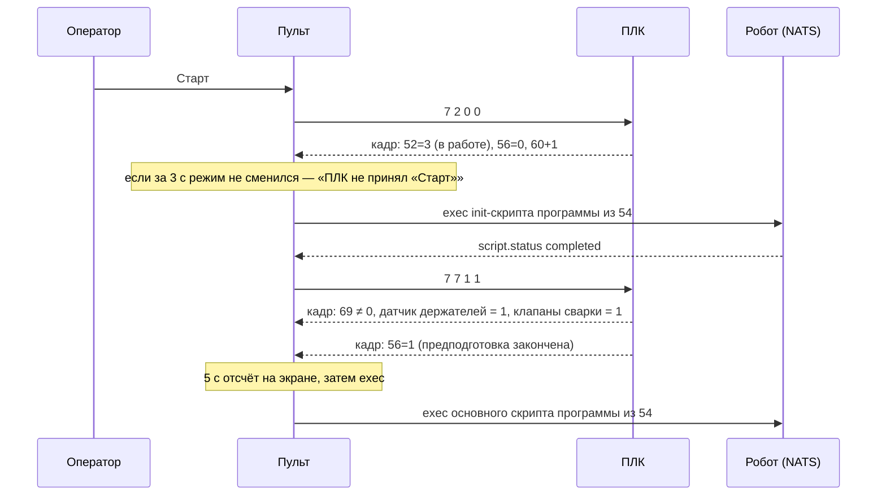
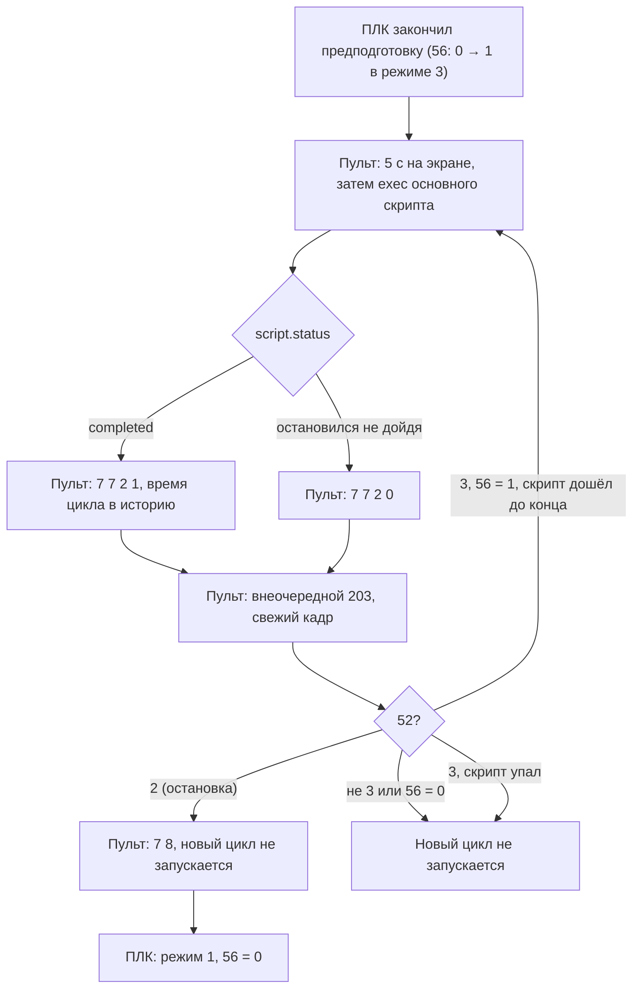

# Протокол пульт ↔ ПЛК (версия 2)

Документ для программиста ПЛК. Описывает, что пульт `line-hmi-qt` отправляет на ПЛК
и что он читает из кадра состояния.

Главный принцип: **все решения принимает ПЛК**. Пульт только передаёт запросы оператора,
показывает состояние из кадра и, пока скрипты робота живут в NATS, запускает их по разрешению
ПЛК и сообщает о результате. Пульт сам не переводит линию в аварию и ничего не считает (кроме
времени цикла для экрана). Сам пульт не пропускает только «Старт» без выбранной детали
или когда робот не в стартовой зоне, и сам показывает окно ручной установки робота.

## 1. Транспорт

- ПЛК — TCP-сервер (`192.168.58.88:2025`). Один пульт на один ПЛК.
- Кроме пульта к ПЛК подключается `robot-behaviour` (скрипты робота). Он тоже шлёт опрос `203`,
но старым кадром из 4 байт `[203, 0, 0, 0]`. ПЛК различает клиентов по соединению: IP пульта
задаётся в настройках ПЛК.

  | Соединение   | Длина опроса `203`                | Что делает ПЛК                                                              |
  | ------------ | --------------------------------- | --------------------------------------------------------------------------- |
  | пульта       | 6 байт `[203, f1, f2, f3, f4, Z]` | отвечает кадром, считает heartbeat'ом пульта, обновляет флаги робота и зону |
  | любое другое | 4 байта `[203, 0, 0, 0]`          | только отвечает кадром; heartbeat, флаги и зона не меняются                 |

- Пульт периодически шлёт опрос `203` и ждёт в ответ кадр состояния ровно **160 байт**
(80 значений int16, little-endian, индексы 0..79). Период («Опрос ПЛК», `plc.pollMs` в
config.json, по умолчанию **1000** мс) и размер кадра («Кадр, байт», `plc.statusBytes`,
чётное, по умолчанию 160) задаются в админке. Если ПЛК шлёт больше, пульт отбрасывает
лишнее перед следующим опросом и показывает в админке «лишние N байт от ПЛК»; если
меньше — кадр не дочитывается, и ПЛК считается без связи. После любой команды и в конце
каждого скрипта пульт шлёт внеочередной опрос: ПЛК должен отвечать на `203` с любой частотой.
- Команды идут в тот же сокет. **На команды ПЛК ничего не отвечает.** Принята команда или нет,
пульт понимает по следующим кадрам: сменился режим (ячейка 52) — принята; режим за 3 с
не сменился — не принята, и пульт пишет «ПЛК не принял». Для «Выйти из E-STOP» к сообщению
добавляется список оставшихся причин аварии (раздел 4).
- Все значения в кадре — int16. Счётчики (60, 62, 63) после 32767 переходят в 0;
пульт сравнивает их на «изменилось», а не «выросло».

### Сторожевые таймеры

| Сторона | Условие                        | Что делает                                                                                                                |
| ------- | ------------------------------ | ------------------------------------------------------------------------------------------------------------------------- |
| Пульт   | 3 с нет кадра в ответ на `203` | Шлёт полный стоп роботу в NATS (`motion`, `behaviour`, `script`), показывает «Нет связи с ПЛК». Новый скрипт не запускает |
| ПЛК     | 3 с не приходил `203`          | Запрещает старт, текущий цикл считает прерванным (брак — на усмотрение ПЛК). Это не авария                                |

## 2. Команды пульт → ПЛК

| Кадр                | Когда пульт отправляет                                    | Смысл для ПЛК                                                                                                                |
| ------------------- | --------------------------------------------------------- | ---------------------------------------------------------------------------------------------------------------------------- |
| `203 f1 f2 f3 f4 Z` | раз в секунду и внеочередно после команд                  | Опрос + heartbeat пульта + состояние робота (см. ниже). Ответ — кадр состояния                                               |
| `7 1 N X`           | оператор выбрал деталь; в админке переключили тензодатчик; при входе в Estop | Выбрана программа `N` (1, 2) или `N = 0` — снять выбор. Тензодатчик `X` (0 — игнорировать, 1 — учитывать). Если `N` сменилась (в том числе на 0) — обнулить годные и брак |
| `7 2 0 0`           | кнопка «Старт» в режиме 1, оператор выбрал деталь, `Z ≠ 0` | Запрос старта: режим 1 → 3, ячейка 60 + 1                                                                                  |
| `7 3 0 0`           | кнопка «Стоп» на экране в режиме 3                        | Запрос стопа (то же, что кнопка СТОП на корпусе): режим 3 → 2                                                                |
| `7 5 0 0`           | «Выйти из E-STOP» в окне аварии                           | Запрос выхода из аварии. ПЛК проверяет, что всё сделано                                                                      |
| `7 7 R S`           | скрипт робота закончился                                  | Отчёт о скрипте. `R`: 1 — init, 2 — основной. `S`: 1 — дошёл до конца, 0 — остановился, не дойдя                             |
| `7 8 0 0`           | в режиме 2 робот закончил работу                          | Стоп отработан: текущий скрипт закончился, новый пульт не запустит. ПЛК переводит линию из 2 в 1 и обнуляет 56               |
| `99 1` / `99 0`     | окно «Сервис»: `99 1` только в режиме 1, иначе сообщение «ПЛК ещё не в стартовом положении»; `99 0` всегда | Сервисный режим вкл/выкл (без изменений)                                                                                     |
| `2 n 1` / `2 n 0`   | окно «Сервис», только в режиме 5; в других режимах кнопки DO неактивны | Дискретный выход `n` вкл/выкл (без изменений)                                                                                |

Команды `7 4` (аварийный стоп с пульта) больше нет: в аварию линия входит только по физической
кнопке, решение принимает ПЛК. Команды `7 6` («Проверить» в ручной установке) тоже нет:
ручную установку пульт определяет сам по зоне робота (6.5).

Пока программа не выбрана (ячейка 54 = 0), переключатель тензодатчика в админке неактивен.
Пульт не считает деталь выбранной, пока оператор не нажмёт «Деталь 1» или «Деталь 2»
в этом сеансе: при старте пульта выбор пустой. После «Стоп» пульт сбрасывает выбор на
экране, когда кадр ушёл из режима 3, и `7 1` при стопе не шлёт. При входе в Estop шлёт
`7 1 0 X`. Если в кадре 54 ещё не 0, кнопки «Деталь 1/2» всё равно не считаются нажатыми.
Если ПЛК не принял `7 1 N X`, на экране останется прежняя.

### Байты опроса `203 f1 f2 f3 f4 Z`

Опрос — ровно 6 байт. Каждый флаг занимает свой байт: 0 — нет, 1 — да.

| Байт | Поле                                                              | Значения                          |
| ---- | ----------------------------------------------------------------- | --------------------------------- |
| 0    | код опроса                                                        | 203                               |
| 1    | `f1` — пульт подключён к NATS                                     | 0/1                               |
| 2    | `f2` — CTRL жив (heartbeat `motion.status` не старше 2 с)         | 0/1                               |
| 3    | `f3` — Behaviour жив (heartbeat `behaviour.status` не старше 2 с) | 0/1                               |
| 4    | `f4` — скрипт выполняется (`script.status.running`)               | 0/1                               |
| 5    | `Z` — стартовая зона робота                                       | 0 — ни в одной, 1..4 — номер зоны |

`Z` — в какой стартовой зоне стоит робот. Зоны —
прямоугольные области по `x, y, z, r`, их границы задаются в админке пульта. Только из этих зон
init-скрипт может сам вывести робота в старт. Пульт шлёт `Z` всегда и при `Z = 0` не шлёт `7 2`;
ПЛК может дополнительно отклонить старт при `Z = 0`. Во время работы ПЛК `Z` игнорирует.

## 3. Кадр состояния (ответ на `203`)

160 байт (по умолчанию, см. раздел 1), int16 little-endian. Индексы ниже — номера int16, не байтов.

### 3.1. Новые ячейки 52..79

| int16  | Поле                              | Значения                                                                                                     |
| ------ | --------------------------------- | ------------------------------------------------------------------------------------------------------------ |
| 52     | Режим линии                       | 0 — ПЛК загружается, 1 — готов, 2 — остановка, 3 — в работе, 4 — Estop, 5 — Service (раздел 5)               |
| 53     | Резерв                            | 0. Стоп теперь — режим 2                                                                                     |
| 54     | Выбранная программа               | 0 — не выбрана, 1 — Деталь 1 (ламели + большие держатели), 2 — Деталь 2 (ламели + малые держатели)           |
| 55     | Тензодатчик                       | 0/1 — эхо `X` из `7 1 N X`                                                                                   |
| 56     | Предподготовка закончена          | В режимах 2, 3: 0 — идёт предподготовка, 1 — закончена, можно запускать основной цикл. В 1, 4, 5 — 0         |
| 57     | Vision 1                          | 0/1, 1 — работает                                                                                            |
| 58     | Vision 2                          | 0/1, 1 — работает                                                                                            |
| 59     | Долго нет ламелей                 | 0/1, 1 — да. Причина аварии (раздел 4)                                                                       |
| 60     | Разрешение init                   | Счётчик. ПЛК увеличивает на 1, когда разрешает запустить init-скрипт                                         |
| 61     | Долго нет держателей ламелей      | 0 — нет, 1 — малые, 2 — большие, 3 — оба. Причина аварии (раздел 4)                                          |
| 62     | Годные                            | Счётчик, считает ПЛК                                                                                         |
| 63     | Брак                              | Счётчик, считает ПЛК                                                                                         |
| 64     | Можно выключать питание           | 0/1                                                                                                          |
| 65     | Сварка долго не отрабатывает      | 0/1, 1 — да: ПЛК отправил команду на сварку и получил в ответ ошибку или не дождался выполнения. Причина аварии (раздел 4) |
| 66     | Долго не можем взять держатель    | 0/1, 1 — да. Причина аварии (раздел 4)                                                                       |
| 67     | Долго не можем взять ламели       | 0/1, 1 — да. Причина аварии (раздел 4)                                                                       |
| 68     | Резерв                            | 0                                                                                                            |
| 69     | Тип ламели на выдаче              | 0 — на выдаче пусто, 1, 2 — тип ламели. С выбранной программой не связан. Пусто — не авария: долгое отсутствие ламелей ПЛК сообщает только в 59 |
| 70..79 | Резерв                            | 0                                                                                                            |

Пульт определяет, что ПЛК жив, только по факту прихода кадра (не позже 3 с назад).

Предподготовка — начало режима 3, пока 56 = 0. Отдельных ячеек по её пунктам нет; окно
предподготовки пульт строит по кадру:

| Строка окна                                   | Готово, когда                                                     |
| --------------------------------------------- | ----------------------------------------------------------------- |
| Ламель на выдаче                              | int16[69] ≠ 0                                                     |
| Большие / малые держатели ламелей на месте    | Деталь 1: int16[25] = 1; Деталь 2: int16[1] = 1                   |
| Робот готов                                   | init-скрипт дошёл до конца (`script.status`, пульт сам)           |
| Клапаны сварки в безопасном положении         | int16[10..14], [16] все = 1                                       |

ПЛК ставит 56 = 1 по своим условиям, но пульт рассчитывает, что это те же четыре пункта.
Результат init ПЛК узнаёт из `7 7 1 S`. По переходу 56: 0 → 1 в режиме 3 пульт запускает
основной скрипт. ПЛК обнуляет 56, когда линия уходит из режимов 2 и 3.

### 3.2. Старые ячейки, которые остаются

Пульт читает их только для индикаторов на экране, решений по ним не принимает.

| int16      | Поле                               | Значения                                                                         |
| ---------- | ---------------------------------- | -------------------------------------------------------------------------------- |
| 1          | Датчик малых держателей ламелей    | 1 — есть                                                                         |
| 10..14, 16 | Клапаны сварки                     | 1 — безопасное положение. Все = 1 — сварка готова                                |
| 32         | Датчик импульса сварки             | 0/1 — импульс сварки. Пульт только показывает в буфере, решений по нему не принимает |
| 25         | Датчик больших держателей ламелей  | 1 — есть                                                                         |
| 50         | Кнопки корпуса (защёлка ПЛК)       | 10 — СТОП, 20 — СТАРТ, 30 — e-stop                                               |
| 51         | Цепь e-stop: грибок и двери        | 0 — грибок зажат и/или двери открыты, 1 — норма. Пока 0, «Выйти из E-STOP» неактивна |

В сервисном режиме int16[0..49] показывают состояние дискретных выходов, как сейчас.

### 3.3. Что удаляется

- Байты предподготовки 24, 25, 26..45 и ячейки предподготовки 65..67 — предподготовку пульт
показывает по датчикам (3.1).
- Двери открыты (56) — двери в цепи e-stop, их состояние в 51. Ячейка 56 теперь —
«предподготовка закончена».
- Стоп запрошен (53) — вместо него режим 2 «остановка».
- Режимы «Prep» (2) и «ручная установка робота» (5): предподготовка — часть режима 3 (ячейка 56),
ручную установку определяет пульт. Номера 2 и 5 отданы под «остановку» и Service.
- Замечания int16[52..59] — больше не нужны, ячейки отданы под новый блок.
- Станции ламелей, малых и больших держателей ламелей int16[40..42] — пульт их не учитывает.
- Vision 1 / Vision 2 перенесены из int16[45] / [46] в ячейки 57 / 58.
- Единый код аварии в 56 и «почему старт невозможен» в 61 — заменены флагами причин аварии
в 59, 61 (раздел 4).

## 4. Причины аварии

Отдельного кода аварии нет. Каждая причина — свой флаг, одновременно может быть активно
несколько. Пульт показывает в окне аварии все активные причины списком и обновляет его по
каждому кадру: снятая причина сразу пропадает.

| Причина                         | Откуда пульт её знает                                   |
| ------------------------------- | ------------------------------------------------------- |
| Отожмите грибок и/или закройте двери | int16[51] = 0                                      |
| Долго нет ламелей               | int16[59] = 1                                           |
| Долго нет держателей ламелей малых    | int16[61] = 1 или 3                               |
| Долго нет держателей ламелей больших  | int16[61] = 2 или 3                               |
| Сварка долго не отрабатывает    | int16[65] = 1                                           |
| Долго не можем взять держатель  | int16[66] = 1                                           |
| Долго не можем взять ламели     | int16[67] = 1                                           |
| Клапаны сварки не в безопасном положении | int16[10..14], [16] не все = 1                 |
| Vision 1 / Vision 2 не работает | int16[57] / [58] = 0                                    |
| Нет связи с NATS, CTRL или Behaviour не отвечает | пульт сам (`f1`, `f2`, `f3` в `203`)   |
| Скрипт робота не дошёл до конца | пульт сам: после него он отправил `7 7 R 0`             |

Отдельной строкой окно показывает, в стартовой ли зоне робот (`Z` из `203`). Это не причина
аварии, а подсказка: при `Z = 0` после выхода из аварии пульт покажет окно ручной установки.

Флаги 59, 61, 65, 66, 67 ПЛК держит, пока условие есть, в любом режиме, не только в аварии.
Ячейка 61 — не 0/1, а код типа держателей (1 малые, 2 большие, 3 оба).
В какой момент из-за них уходить в аварию и сколько ждать («долго»), решает ПЛК. Флаги 65..67
ПЛК снимает, когда причина устранена, — не позже, чем принимает выход из аварии (`7 5`).

Отдельной ячейки «почему старт невозможен» нет. Старт возможен в режиме 1; деталь и зону
пульт проверяет сам: при 54 = 0 он показывает «Сначала выберите деталь», при `Z = 0` кнопка
«Старт» неактивна и открыто окно ручной установки.

## 5. Режимы линии (ячейка 52)

Ручной установки среди режимов нет: если ПЛК в режиме 1, а робот не в стартовой зоне,
окно ручной установки показывает пульт (6.5).

Переходы, которые здесь не показаны, ПЛК делает на своё усмотрение — пульт просто покажет
новый режим. Аварию ПЛК хранит между включениями питания.

## 6. Сценарии

### 6.1. Включение

1. Пульт подключается и шлёт `203 f1 f2 f3 f4 Z`.
2. ПЛК по сохранённой аварии выбирает режим: 1 или 4.
3. Пульт показывает окно по режиму, в режиме 1 при `Z = 0` — окно ручной установки (6.5).
  Сам ничего не запускает, даже если ПЛК уже в режиме 3: скрипт пульт запускает только
  по изменению ячеек 60 или 56, которое он увидел сам.

### 6.2. Выбор детали и тензодатчик

1. Оператор выбирает деталь → `7 1 N X` (`X` — текущая настройка тензодатчика из админки).
2. ПЛК записывает 54 и 55, при смене `N` обнуляет 62 и 63.
3. Переключение тензодатчика в админке → `7 1 N X` с текущей программой `N`.

### 6.3. Старт, предподготовка, первый цикл

- Пульт запускает init-скрипт каждый раз, когда ячейка 60 изменилась, и только если увидел
предыдущее значение (после старта пульта первое значение просто запоминается).
- Если init остановился, не дойдя до конца (и это не стоп), пульт шлёт `7 7 1 0`. ПЛК уходит
в аварию, пульт показывает причину «Скрипт робота не дошёл до конца».
- При `Z = 0` пульт `7 2` не шлёт (6.5).

### 6.4. Основной цикл и стоп

- Годную ПЛК засчитывает по своим условиям, в том числе по `7 7 2 1`. Брак — только ПЛК.
- ПЛК переходит в режим 2 в момент нажатия стопа. Пульт решает о перезапуске по свежему
кадру, запрошенному сразу после конца скрипта, поэтому стоп, нажатый в последнюю секунду
цикла, не теряется.
- Стоп (`7 3` или кнопка СТОП на корпусе) → ПЛК переходит из 3 в 2 и остаётся в 2,
пока не придёт `7 8`. 56 в режиме 2 не меняется: по ней пульт понимает, что останавливает —
предподготовку или цикл. Пульт `7 1` при стопе не шлёт: выбор детали на экране сбрасывается,
когда кадр ушёл из режима 3.
- Пока режим 2, пульт показывает всплывающее окно «Остановка работы».
- Стоп в цикле (56 = 1): пульт доигрывает текущий цикл, шлёт `7 7 2 S`, затем `7 8`
и не перезапускает. ПЛК по `7 8` переводит линию в режим 1. Если цикл не закончился за таймаут
стопа (в админке пульта, по умолчанию 30 с), пульт шлёт роботу полный стоп, затем `7 7 2 0` и `7 8`.
- Стоп в предподготовке (56 = 0): если init-скрипт идёт, пульт шлёт роботу полный стоп,
дожидается конца скрипта, шлёт `7 7 1 0`, затем `7 8`. Если init не запущен — сразу `7 8`.
- `7 7 R 0` в режиме 2 — это следствие стопа, а не авария.
- Если пока ждали конца скрипта, ПЛК ушёл в Estop, пульт `7 8` не шлёт.
- Если ПЛК ушёл в режим 1, не дождавшись `7 8`, пульт всё равно доводит скрипт как при стопе
(init останавливает, цикл доигрывает с таймаутом стопа) и шлёт `7 7 R S`, но не `7 8`.
Пока скрипт идёт, «Старт» и выбор детали неактивны, открыто окно «Остановка работы».
Так делать не нужно: ПЛК должен держать режим 2 до `7 8`.
- Если робот упал посреди цикла, пульт шлёт `7 7 2 0` и новый цикл не запускает. ПЛК уходит
в аварию, пульт показывает причину «Скрипт робота не дошёл до конца».

### 6.5. Ручная установка робота

Определяет пульт, ПЛК в ней не участвует.

1. Линия не в работе (ПЛК в режиме 0 или 1, или связи с ПЛК нет), CTRL присылает позу
  робота, а робот не в стартовой зоне (`Z = 0`) →
  пульт на весь экран показывает «Робот не в стартовой зоне», в том числе если робот вышел
  из зоны уже после выбора детали. Слева — шкалы X, Y, Z, R ближайшей включённой зоны:
  минимум слева, максимум справа, метка текущего значения и подсказка «увеличить/уменьшить
  на …». Справа — картинка нужного положения из админки. Робот в зоне, когда все четыре оси
  в диапазоне. Шапка с «Сервис» и «Админ-режим» остаётся доступной. Кнопка «Старт» неактивна.
2. Оператор выставляет робота руками. Как только робот в зоне (`Z ≠ 0`), окно закрывается само.
3. Пока позы робота нет (CTRL не отвечает), окно не показывается, но «Старт» тоже неактивен:
  `Z = 0`.

### 6.6. Авария

1. Кнопка e-stop или открытые двери (51 = 0), долгое отсутствие ламелей или держателей, сварка
  долго не отрабатывает, долго не можем взять держатель или ламели, падение скрипта робота или
  другое решение ПЛК → режим 4. Остановку робота в NATS ПЛК делает сам. Пульт сразу шлёт
  `7 1 0 X` — выбранная программа сбрасывается, после выхода оператор выбирает деталь заново.
2. Пульт показывает окно аварии:
  - «Причины» — все активные причины из раздела 4, обновляются по каждому кадру;
  - в стартовой ли зоне робот;
  - «Перед выходом» — выключить вакуум, разжать сварку, убедиться, что всё нормально (отмечает оператор).
3. Кнопка «Выйти из E-STOP» активна, когда цепь e-stop в норме (51 = 1) и оператор отметил оба пункта
  → `7 5 0 0`.
4. ПЛК проверяет датчики:
  - не принято: режим остаётся 4, окно остаётся, пульт через 3 с пишет «ПЛК не принял» со списком
    оставшихся причин;
  - принято: режим 1. Окно аварии закрывается, когда режим ≠ 4; при `Z = 0` пульт сразу
    покажет окно ручной установки.

### 6.7. Выключение питания

ПЛК держит 64 = 1, когда питание можно снимать. Пульт только показывает «Можно выключать
питание · ДА/НЕТ».

## 7. Что пульт делает сам, без ПЛК

- Админка (доступ только у наладчика): включение и выключение приводов, ручное перемещение
робота, редактирование точек в KV `robot_points`, сервисный режим и дискретные выходы,
настройка стартовых зон и имён скриптов. Это прямое управление в обход ПЛК.
- Задача предподготовки «Робот готов» — по выполнению init-скрипта.
- Время цикла и история запусков (от Старта до Стопа или аварии): деталь, начало и конец,
годные и брак за запуск (разница ячеек 62 и 63), среднее и последнее время цикла, причина
завершения. Хранится в файле на пульте.

